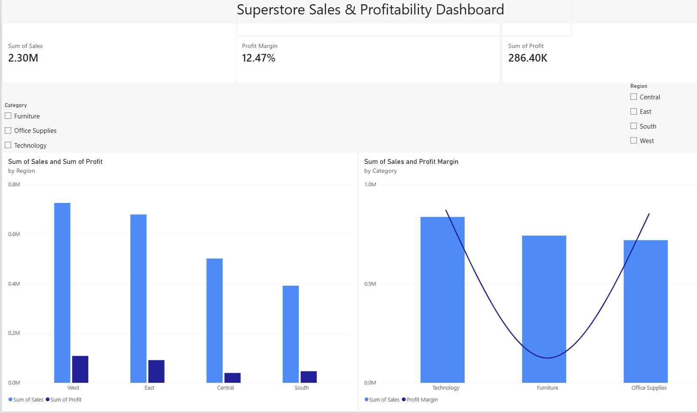

# Superstore Sales & Profitability Analysis

**Author:** Anirudh Pawar
**Enrollment No.:** M24BBAU0266
**Program:** BBA, Bennett University

## Overview
An end-to-end business analytics project using SQL and Power BI to analyze four years
of retail order data — identifying which products, categories, and regions drive
revenue and profit, and uncovering the root cause of a major profitability gap.

## Dataset
[Sample Superstore](https://www.kaggle.com/datasets/vivek468/superstore-dataset-final) (Kaggle)
- 9,994 rows, 21 columns, Jan 2014 – Dec 2017
- Order/shipping details, customer segment, product category, sales, quantity, discount, profit

## Approach
1. **Data loading** — cleaned and loaded the CSV into a SQLite database using Python/pandas.
2. **SQL analysis** — wrote queries for core KPIs, top products, category and region
   breakdowns, and a discount-vs-profit-margin comparison.
3. **Power BI dashboard** — built an interactive dashboard with KPI cards, a combo chart
   (Category sales + profit margin), a region performance chart, and Category/Region
   slicers.

## Key Findings

| Metric | Value |
|---|---|
| Total Sales | $2,297,200.86 |
| Total Profit | $286,397.02 |
| Total Orders | 5,009 |
| Avg. Discount | 15.6% |

**Furniture is the core profitability problem.** It generates nearly as much revenue as
Technology ($741,999.80 vs $836,154.03) but its profit margin is **~7x lower** (2.49% vs
17.40%). The root cause: Furniture carries the **highest average discount (17.4%)** of
any category, while Technology (lowest discount, 13.2%) has the highest margin. Several
individual best-selling products — a Cisco TelePresence system, HON task chairs, a GBC
binding system — are currently breaking even or losing money despite strong sales.

**Regionally**, West leads on both sales and profit; South is smaller in volume but more
profit-efficient than Central.

## Business Recommendation
Reduce discounting on Furniture, especially on high-volume items currently selling at
break-even or a loss. Technology and Office Supplies prove comparable sales volume is
achievable at far better margins with lower discount rates.

## Dashboard


An interactive `.pbix` version and a PDF export are included in this repository.

## Repository Structure
```
├── superstore_sql_analysis.ipynb   # SQL analysis notebook (Python + SQLite)
├── Sample - Superstore.csv         # Source dataset
├── Superstore_Dashboard.pbix       # Power BI dashboard (interactive)
├── Superstore_Dashboard.pdf        # Dashboard export (viewable without Power BI)
├── dashboard_screenshot.png        # Dashboard preview image
└── README.md
```

## How to Run
```bash
pip install pandas
jupyter notebook superstore_sql_analysis.ipynb
```
Open `Superstore_Dashboard.pbix` in Power BI Desktop (free) to explore the interactive dashboard.

## Tools
Python, pandas, SQLite (SQL), Power BI
